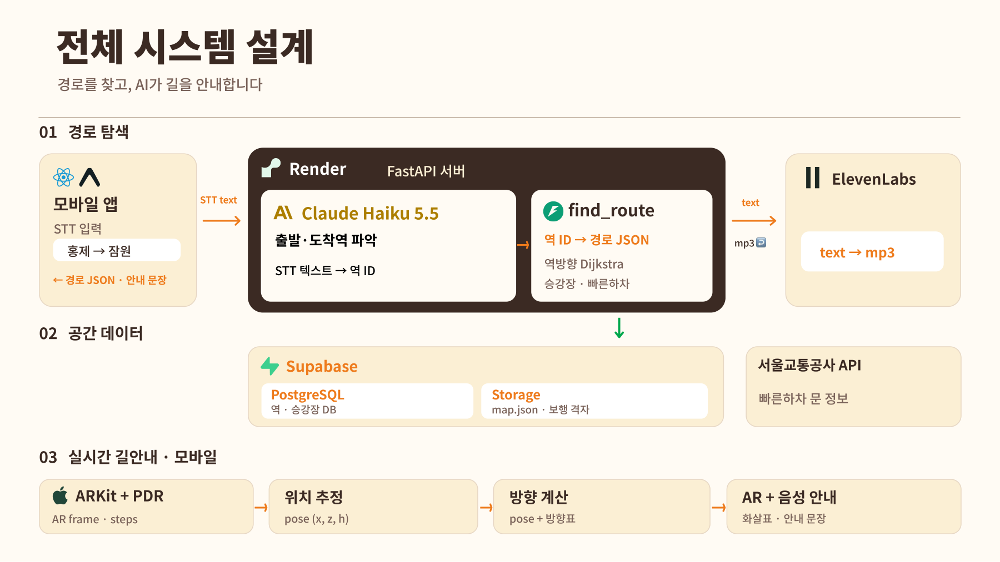
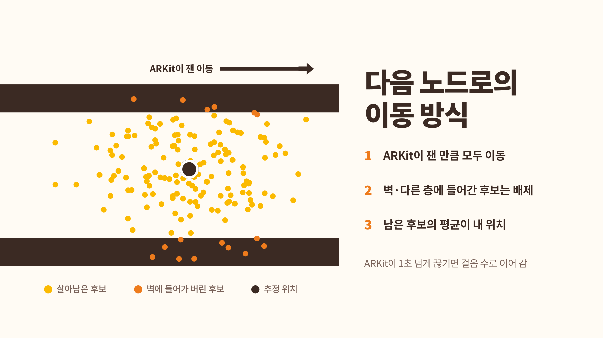
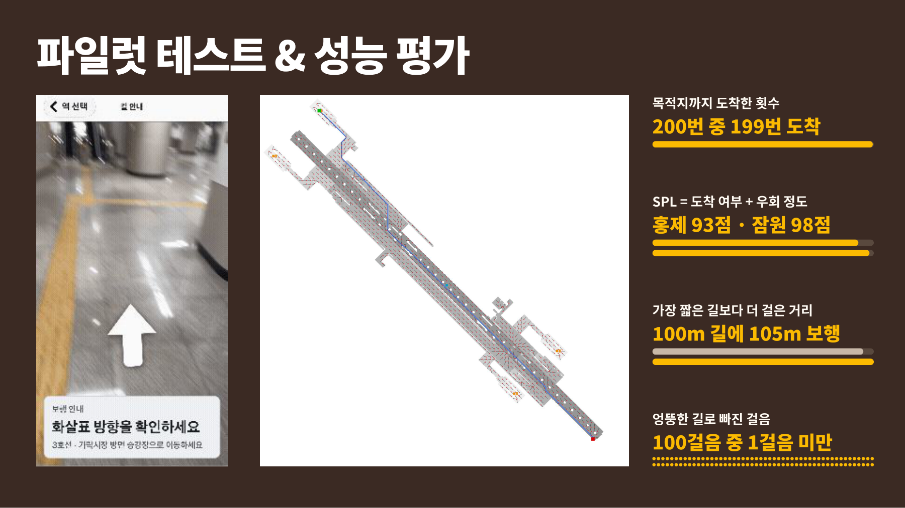
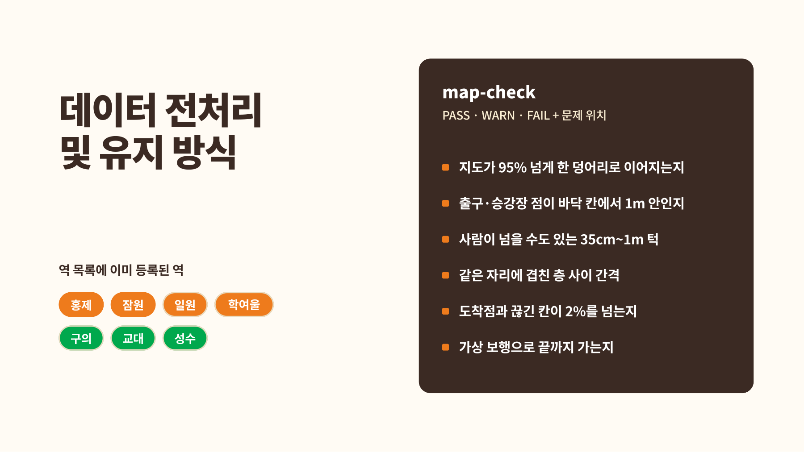

# 역이에요! · Here Station

**지하철 역사 내에서 GPS 없이 길을 알려 주는 화살표 하나.**

사용자가 출발역과 도착역을 정하고 초기 위치·방향을 맞추면, 카메라 화면의 AR 화살표와 음성으로 다음 이동 방향을 안내하는 모바일 앱입니다.


2026 서울AI디지털배움터 청년AI해커톤 · **여기서** 팀

[서비스 페이지](https://toowani.com/here-station/) · [소개서 PDF](docs/presentation/here-station.pdf) · [실행 방법](#0-공통-프로젝트-설정)

[문제와 설계 원칙](#문제와-설계-원칙) · [주요 기능과 이용 흐름](#주요-기능과-이용-흐름) · [시스템 설계](#시스템-설계) · [평가와 지도 관리](#평가와-지도-관리) · [향후 계획](#향후-계획) · [팀 소개](#팀-소개)

## 문제와 설계 원칙

서울교통공사 2025년 6월 현안 업무보고에 따르면 1~8호선 276개 역사에 안내사인 211,652개가 설치되어 있습니다. 역마다 다른 구조와 복잡한 동선, 혼재된 안내 기준 속에서 이용자는 자신의 위치와 진행 방향을 판단해야 합니다.


안내는 **사용자가 서 있는 위치**를 기준으로, **지금 필요한 방향**을 전달합니다. 여러 역에서도 같은 화살표와 안내 방식을 사용합니다.


## 주요 기능과 이용 흐름

### 출구에서 승강장, 열차에서 도착 출구까지

출발역 내부 걷기 → 열차 이동 → 도착역 내부 걷기를 하나의 여정으로 연결합니다. 아래는 발표 자료의 **홍제 → 잠원 예시**입니다.


현재 경로 API는 입력한 출발·도착역에 따라 **직통 3호선** 경로를 계산합니다. 안내 가능한 역은 지도 JSON과 방면별 승강장 연결이 등록된 범위이며, 출발·도착 출구는 1번 출구입니다. 도착역에서는 지정된 계단 앞에서 방향을 맞추고 안내를 다시 시작합니다. 자세한 동작은 [경로 계산 문서](backend/app/routing/README.md)를 참고하세요.

### 출발 전에 한눈에 보는 경로 미리보기

역 내부 도보 거리, 출발·도착 출구, 빠른하차 공공데이터의 추천 문 번호와 이동 순서를 확인합니다.


### 말로 묻고, 귀로 듣는 길 안내

“홍제에서 잠원까지”라고 말하면 AI가 출발·도착역을 파악하고 경로를 찾습니다. 안내 문장은 ElevenLabs를 통해 두더지 캐릭터 **역두**의 목소리로 들려주며, 열차에서 “내렸어”라고 말해 다음 안내로 넘어갈 수 있습니다.


## 시스템 설계

모바일의 음성 인식 결과를 FastAPI 서버에 보내면 Claude가 역을 파악하고 `find_route`를 호출합니다. 서버는 Supabase의 역·승강장 정보와 지도, 빠른하차 API를 사용해 경로를 반환합니다. 이동 중 위치 추정과 화살표 갱신은 모바일에서 처리합니다.



### 보행 격자와 방향표

바닥을 0.25m 칸으로 나누고, 도착점에서 역방향 Dijkstra로 거리와 다음 이동 칸을 계산합니다. 칸마다 약 3m 앞의 보이는 경로를 가리키게 해 화살표가 벽 너머를 향하지 않도록 합니다.


### ARKit과 걸음 수로 위치 추정

ARKit이 측정한 이동량에 따라 위치 후보를 옮기고, 벽이나 다른 층에 들어간 후보를 걸러 위치를 추정합니다. AR 프레임이 1초 넘게 끊기면 PDR의 걸음 수와 방향으로 이동 추정을 이어갑니다.



구현: [서버 경로 계산](backend/app/routing/README.md) · [모바일 방향·도착 처리](apps/mobile/src/navigation/README.md)

## 평가와 지도 관리

### 발표 자료의 경로 평가 결과

홍제·잠원 경로에 대해 발표 자료에서 보고한 결과입니다.



| 지표 | 발표 결과 |
| --- | --- |
| 목적지 도착 | 200번 중 199번 |
| SPL: 도착 여부와 우회 정도 | 홍제 93점 · 잠원 98점 |
| 최단거리 대비 보행 거리 예시 | 최단 100m에 105m 보행 |
| 경로를 벗어난 걸음 | 100걸음 중 1걸음 미만 |

경로 확인과 가상 보행 점검 방법은 [route-inspect](tools/route-inspect/README.md), [map-check](tools/map-check/README.md)에 정리되어 있습니다.

### 지도 전처리와 점검

GLB에서 보행 격자와 주요 지점을 추출하고, `map-check`로 연결 상태, 출구·승강장 위치, 턱과 겹친 층, 도달 가능한 칸과 가상 보행을 점검합니다. 결과는 `PASS` / `WARN` / `FAIL`과 문제 위치로 확인합니다.



위 이미지의 역 목록은 발표 당시 등록 현황입니다. 역 검색 목록은 DB에서 조회하며, 실제 경로 안내에는 해당 역의 지도와 승강장 연결 정보가 함께 필요합니다.

## 향후 계획

음성 안내를 개선하고 진동 안내를 추가하며, 안내 가능한 역을 늘리고 피지컬 디바이스와 연결할 계획입니다.


## 팀 소개


| 이름 | 역할 |
| --- | --- |
| 김동우 | 팀장 · 풀스택 개발 · 기획 |
| 공호준 | 프론트엔드 디자인 |
| 김두영 | ML 프롬프트·LLM 엔지니어링 · 리서치 |
| 김창완 | 프롬프트·LLM 엔지니어링 |
| 박준형 | 백엔드 디자인 |
| 이정훈 | 프론트엔드 디자인 |

---

아래는 개발 환경과 팀별 작업 안내입니다.

## 기술과 역할

| 영역 | 기술 | 역할 |
| --- | --- | --- |
| 모바일 | React Native, TypeScript, Expo Development Build | 화면, 센서, 위치 추정, AR 안내 |
| API | Python, FastAPI, Pydantic | 역 정보, 지도 버전, 경로 계산 |
| DB | Supabase PostgreSQL | 역·시설 정보, 지도 버전, 파일 경로 |
| 파일 | Supabase Storage | 지도 JSON, 원본 GLB, 표시가 필요한 GLB |

서버는 API 코드를 실행하는 환경이다. 위치 추정과 이동 중 화면 갱신은 모바일에서 처리한다. 층별 PNG는 사용하지 않는다.

## 폴더

| 경로 | 담당 |
| --- | --- |
| `apps/mobile/` | 모바일 앱 |
| `backend/app/` | API와 서버 경로 계산 |
| `tools/map-preprocess/` | GLB에서 정보 추출 |
| `tools/map-check/` | GLB → JSON 팀이 지도를 넘기기 전 돌리는 점검 |
| `tools/route-inspect/` | 서버 경로 결과 눈으로 확인, 가상 보행 고정 데이터 생성 |
| `contracts/` | 팀이 합의할 API·지도 형식 |
| `infra/` | DB·스토리지·배포 설정 |
| `docs/` | 구조와 협업 방법 |

## 0. 공통: 프로젝트 설정

Node 24와 Docker Desktop을 준비한다. iOS는 Xcode 서명과 실기기 개발자 모드를 설정한다.

```bash
git clone https://github.com/dwjustin/here-station-v3.git
cd here-station-v3
```

루트 `.env.example`을 참고해 서버 `.env`를 설정한다. 모바일은 `apps/mobile/.env.local`에 `EXPO_PUBLIC_API_URL=http://개발PC의LAN주소:8000`을 지정한다. 실기기와 PC는 같은 Wi-Fi를 사용한다. 서버 비밀 키는 모바일에 넣지 않는다.

백엔드: Docker Desktop을 켠 뒤 프로젝트 루트에서 실행한다. 아래 로컬 실행 방법과 둘 중 하나만 사용한다.

```bash
docker compose -f infra/compose.yaml up --build
```

모바일: 별도 터미널에서 프로젝트 루트 기준으로 실행한다.

```bash
nvm install 24
nvm use 24
cd apps/mobile
npm ci
npm run ios -- --device
```

이후 개발 서버만 실행할 때는 `npm start`를 사용한다. API·좌표·입출력 형식은 초안이며, 변경 시 관련 팀과 공유하고 호출부도 수정한다.

`No script URL provided`가 뜨면 기기의 Debug 앱이 Mac의 Metro 개발 서버에서 JavaScript를 받지 못한 상태다. `expo-dev-client` 추가 전 설치한 앱은 아래 명령으로 네이티브 설정을 갱신한 뒤 다시 설치한다.

```bash
cd apps/mobile
npm ci
npx expo prebuild --platform ios --no-install
npm run ios -- --device
```

이후에는 `npm start`를 켜 둔 채 iPhone과 Mac을 같은 Wi-Fi에 연결하고, 개발 클라이언트에서 서버를 선택하거나 터미널의 QR 코드를 스캔한다. iPhone 설정에서 앱의 로컬 네트워크 접근을 허용한다. `.env.local`의 `EXPO_PUBLIC_API_URL`은 백엔드 주소이며 Metro 주소와 별개다.

Metro 없이 실행하려면 `apps/mobile`에서 `npm run ios:standalone`으로 JavaScript 번들을 포함한 Release 앱을 설치한다. 코드 변경은 다시 빌드해야 반영되며 API 서버 연결은 별도로 필요하다.

## 1. GLB → JSON 팀

- 전처리 코드: `tools/map-preprocess/`. 넘기기 전 `tools/map-check/`로 점검한다.
- 파일은 Supabase Storage의 비공개 `station-maps` 버킷에 저장한다.

| 파일 | 버킷 안의 경로 |
| --- | --- |
| 원본 GLB | `stations/{station_id}/{version}/source.glb` |
| 생성한 지도 JSON | `stations/{station_id}/{version}/map.json` |

좌표·층·보행 연결을 검증하고, 역 ID·버전·파일 경로를 팀장에게 전달해 `station_maps`에 등록한다. 형식은 `contracts/`를 기준으로 협의한다. 실제 GLB·전체 지도 JSON은 Git에 커밋하지 않는다.
contracts 바꾸게 되면 알려주세용(코드 반영해야됨.).

## 2. 위치 추적 팀

- 초기 위치·방향 설정, 센서 기반 추적·오차 보정, 추적 시작·종료를 구현한다.
- 추적 코드: `apps/mobile/src/localization/` (`localizer.ts` 입자 필터, `pdr.ts` 걸음 감지, `usePdrSteps.ts` 걸음 센서, `virtualWalk.ts` 가상 보행).
- 방향·도착 계산: `apps/mobile/src/navigation/` (`mapGrid.ts`, `guidance.ts`, `trip.ts`). AR 카메라 입력은 `apps/mobile/src/components/ArView.tsx`(ViroReact).
- 연결: `apps/mobile/src/screens/GuideScreen.tsx`가 프레임·걸음을 지금 구간의 `localizer`에 넣고, `pose`로 화살표와 구간 전환(`legA → onTrain → legB → arrived`)을 정한다.

입출력과 연결 예시: [방향·도착 처리](apps/mobile/src/navigation/README.md).

## 3. UI/UX 디자인 + 프론트엔드 팀

- 디자인을 통일하고 역 검색·로딩·오류·카메라 권한·길 안내 UX를 개선한다.
- 화면: `apps/mobile/src/screens/`.
- 공통 UI와 카메라·나침반: `apps/mobile/src/components/`.
- 색상·간격·글자 크기: `apps/mobile/src/theme/token.ts`.
- 만들어 둔 API 함수와 위치 추정 출력을 사용하고, 화면 표시와 계산 로직을 분리한다.

## 백엔드 실행

Python 3.11 이상이 필요하다.

```bash
cd backend
python3 -m venv .venv
source .venv/bin/activate
python -m pip install -e .
uvicorn app.main:app --reload --host 0.0.0.0 --port 8000 --env-file ../.env
```

- 상태 확인: http://localhost:8000/health
- API 문서: http://localhost:8000/docs

### 역 검색

```bash
curl --get http://localhost:8000/stations --data-urlencode 'q=일원'
```

```json
{"stations":[{"id":"ilwon","name":"일원","lines":["3"]}]}
```

`GET /stations`는 등록된 역 전체를 반환한다. `q`는 최대 100자이며, 역 이름 또는 ID로 부분 검색한다. 앞뒤 공백과 영문 대소문자는 무시하고 `일원역`처럼 접미사 `역`을 붙여도 검색된다. 검색 결과가 없으면 `200`과 빈 `stations` 배열을 반환한다. 출발·도착 선택에 같은 API를 사용하며 도착역을 출발역에 따라 제한하지 않는다.

역 정보 모델은 `backend/app/stations/schemas.py`에 있다. `search_stations()`는 Supabase REST API를 통해 `stations` 테이블에서 `id`, `name`, `lines`만 조회하며 DB에서 검색한다. 새 역을 테이블에 등록하면 다음 검색에 반영된다. 원본 지도 파일을 업로드하는 것만으로 역이 자동 등록되지는 않는다. 검색 목록과 실제 경로 탐색 지원 범위는 별개다. 현재는 지도와 방면별 승강장 연결이 등록된 직통 3호선 역 사이의 경로를 계산한다.

루트 `.env`의 `SUPABASE_URL`, `SUPABASE_SECRET_KEY`가 필요하다. `SUPABASE_SECRET_KEY`에는 서버 전용 secret 키를 사용하며 publishable 키를 넣지 않는다. 로컬 실행 시 위의 `--env-file ../.env`로 읽고, Docker Compose는 `env_file`로 주입한다. 연결 설정 누락·DB 연결 실패는 `503`, 잘못된 DB 응답은 `502`를 반환한다. 키를 프론트에 전달하지 않는다.

### 경로 요청

```bash
curl -X POST http://localhost:8000/routes \
  -H 'Content-Type: application/json' \
  -d '{"origin_station_id":"hongje","destination_station_id":"jamwon"}'
```

위 요청은 홍제 → 잠원 예시다. 입력한 출발·도착역을 조회해 직통 3호선의 방향과 경로를 계산하며, 출발·도착 출구는 1번 출구다. 응답은 역(구간)마다 보행 칸 전부의 안내 방향이며, 형식은 [공유 형식](contracts/README.md)을 따른다. 로컬에서는 `data/maps/`(gitignore, 환경 변수 `MAP_DIR`로 변경 가능)에서 지도를 읽는다. Render(`RENDER=true` 자동 설정)에서는 `SUPABASE_URL`, `SUPABASE_SECRET_KEY`, `STORAGE_BUCKET=station-maps`로 버킷 루트의 `{station_id}.json`을 내려받는다. 지도는 역마다 첫 요청 때 한 번 읽어 메모리에 두므로(`grid.load_map` 캐시) 지도 교체 후에는 서버를 재시작한다. 경로 방향 계산, 승강장 연결(DB), 빠른하차 정보는 요청마다 새로 한다. 미등록 역은 `404`, 누락·잘못된 타입·빈 문자열·동일 역·미지원 노선·환승·승강장 연결 누락은 `422`, 지도 파일 없음·Storage 연결 실패·설정 누락은 `503`, 잘못된 지도 형식은 `502`를 반환한다.

### 말로 길 찾기와 음성 안내

화면을 보지 않고 에어팟으로만 들으며 길을 찾을 수 있다.

1. **시작 (말 → 경로)**: 첫 화면의 "말로 길 찾기"를 누르면 앱이 질문하고 바로 듣는다. 기기 음성 인식(`expo-speech-recognition`, 한국어)으로 만든 글자를 `POST /voice/turn`에 보낸다. 서버는 Claude(`claude-haiku-5-5`, effort `low`, 음성 대화라 지연이 짧은 모델)에 DB 역 목록과 함께 보내고, Claude는 역을 알아들으면 `find_route` 도구로 경로를 계산해 결과를 말로 설명한다. 역이 빠지면 한 가지만 되묻고, 앱은 화면을 누르지 않아도 다시 듣는다. 경로가 나오면 앱은 설명을 읽은 뒤 안내 화면으로 넘어간다.
2. **걷는 동안 (규칙, LLM 안 씀)**: `apps/mobile/src/voice/voiceGuide.ts`가 화살표 각도를 "왼쪽으로 도세요", "앞으로 계속 가세요", "뒤로 돌아 주세요"로 바꾼다. 같은 방향이 1초 이어져야 말하고, 돌라는 말은 돌 때까지 8초마다 다시 한다. 화살표가 4초 동안 없으면 휴대폰을 들어 달라고 한다. 목적지 10m 안이면 한 번 알려 준다.
3. **열차·도착**: 승강장에 닿으면 호선·방면·내릴 역·칸과 문 번호를 말한다. 열차 안에서는 "내렸어"라고 말하면(또는 버튼) 도착역 안내를 시작하고, 출구에 닿으면 도착을 알린다.

말하기는 `GET /voice/tts?text=...`(ElevenLabs `eleven_flash_v2_5`, 한국어, mp3)를 재생한다. 같은 문장은 서버 메모리에 캐시한다. 모든 안내는 `ELEVENLABS_VOICE_ID`의 목소리 하나로만 말한다. 6초 안에 재생이 시작되지 않으면 한 번 더 시도하고, 그래도 안 되면 소리 없이 넘어간다(같은 문장은 안내 카드에 보인다).

```bash
curl -X POST http://localhost:8000/voice/turn -H 'Content-Type: application/json' \
  -d '{"messages":[{"role":"user","text":"홍제에서 잠원까지 가고 싶어"}]}'
curl -o hello.mp3 --get http://localhost:8000/voice/tts --data-urlencode 'text=왼쪽으로 도세요.'
```

- 루트 `.env`에 `ANTHROPIC_API_KEY`, `ELEVENLABS_API_KEY`가 필요하다. `ELEVENLABS_VOICE_ID`로 목소리를 바꾼다(비우면 문서 예시 목소리). 키는 앱에 넣지 않는다.
- 키가 없으면 `/voice/turn`·`/voice/tts`는 `503`이다. 앱은 기기 목소리로 바꾸지 않으므로 안내 소리가 나지 않는다.
- 위치 추정은 AR 카메라를 쓰므로 화면을 보지 않더라도 휴대폰은 카메라가 앞을 보게 가슴 앞에 들어야 한다. 주머니에 넣으면 화살표(방향)를 알 수 없어 "휴대폰을 들어 달라"고 안내한다. 안내 중에는 화면 잠금을 막는다.
- 새 네이티브 모듈(음성 인식·오디오·화면 켜짐)과 마이크·음성 인식 권한이 추가되어 개발 빌드를 다시 해야 한다(`npm run ios -- --device`).

백엔드 테스트는 `backend`에서 실행한다.

```bash
python -m pip install -e '.[test]'
python -m unittest discover -s tests
```

## 현재 들어 있는 것

DB 역 검색, 입력한 직통 3호선 역 사이의 칸별 안내 방향 계산(서버), AR + PDR 입자 필터 위치·방향 추정과 화살표, 승강장·열차·도착역 보행 구간 전환(앱), 음성 경로 요청·안내, 개발 모드 가상 보행이 있다. 역별 안내 범위는 지도와 승강장 연결 등록 상태에 따른다. 현장 센서 확인과 지도·계단 표지 대조를 이어간다.

먼저 [구조](docs/architecture.md), [협업](docs/contributing.md), [공유 형식](contracts/README.md)을 읽고 작업 브랜치를 만든다.
